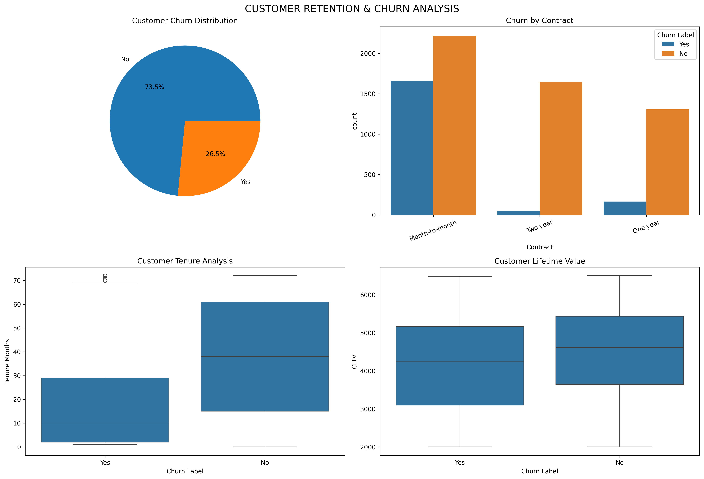

# 📊 Customer Retention & Churn Analysis

### 🚀 Future Interns – Data Science & Analytics Internship
### 📌 Task 2 – Customer Retention & Churn Analysis

---

## 📖 Project Overview

This project focuses on analyzing customer data to identify churn patterns, understand customer retention, and study Customer Lifetime Value (CLTV).

The main goal is to understand why customers leave a subscription-based service and provide actionable recommendations to improve customer retention.

## 🎯 Project Objectives

- 📉 Analyze customer churn and retention rates.
- 🔍 Identify the major reasons for customer churn.
- 📊 Analyze churn based on contract type.
- 📅 Study customer tenure patterns.
- 💰 Understand Customer Lifetime Value (CLTV).
- 💡 Provide recommendations to reduce customer loss.

## 📂 Dataset Information

- **Dataset:** Telco Customer Churn
- **Total Customers:** 7,043
- **Churned Customers:** 1,869
- **Retained Customers:** 5,174

## 🛠️ Tools & Technologies

- 🐍 Python
- 🐼 Pandas
- 🔢 NumPy
- 📊 Matplotlib
- 🎨 Seaborn
- 💻 Google Colab

## 📈 Key Performance Indicators (KPIs)

| Metric | Value |
|---|---:|
| Total Customers | 7,043 |
| Churned Customers | 1,869 |
| Retained Customers | 5,174 |
| Churn Rate | 26.54% |
| Retention Rate | 73.46% |

## 📊 Dashboard Preview

## 🔍 Analysis Performed

1. Customer Churn Distribution
2. Churn Analysis by Contract Type
3. Customer Tenure Analysis
4. Customer Lifetime Value Analysis
5. Churn Reasons Analysis

## 💡 Business Recommendations

- 🤝 Improve customer support and service quality.
- 🎁 Provide special offers for long-term contracts.
- 🆕 Focus on customers with shorter tenure.
- 😊 Improve customer satisfaction.
- 📞 Contact customers who show signs of leaving.

## 📁 Project Files

- 📓 Python Analysis Notebook
- 📊 Customer Retention Dashboard
- 📝 Final Analysis Report
- 📄 Customer Churn Analysis CSV
- 📄 Contract Analysis CSV
- 📄 Tenure Analysis CSV
- 📄 CLTV Analysis CSV

## 🏁 Conclusion

This project provides insights into customer churn behavior, contract patterns, tenure, and customer lifetime value.

The findings can help businesses understand customer loss and develop effective strategies to improve customer retention.

---

